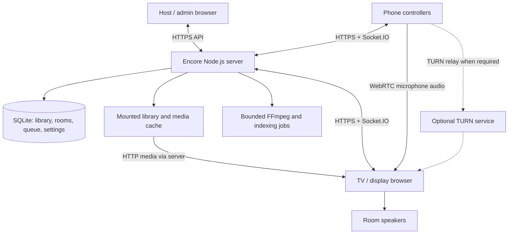

> Historical design draft. Persistent storage, local libraries, account roles and display takeover in this document have been superseded by the stateless, single-main-screen implementation. See [current implementation](server-hosted-implementation.md).

# Encore Karaoke: server-hosted overhaul

Status: architecture and delivery draft, October 18, 2026. No runtime changes are included.

## Proposed experience

Run Encore as a headless server. Open its website on a TV or a computer connected to the TV, start a room, and scan the displayed QR code from phones. Phones become songbooks and controllers, with an optional microphone mode. The display plays the backing track, renders lyrics, and outputs the room's audio.

The recommended first release is a self-hosted, single-server installation with one active playback display per room. Keep the existing browser playback engine and mobile interface, move shared state into the backend, and introduce phone microphones behind a hardware validation milestone. A remotely hosted server can use the same architecture; local playback and direct phone-to-display audio should remain possible.

### A typical session

1. The host opens `https://karaoke.example` on the display device. Initial setup pairs that display with a host account or locally provisioned host credential; visiting this URL alone does not confer host rights.
2. The host selects **Start karaoke**, enabling browser audio and requesting fullscreen where supported. The display shows the room name, QR code, short join code, and an empty queue.
3. A guest scans the QR code, opens the join page, chooses a nickname, and enters the room. A manual code provides an alternative to scanning.
4. The guest searches the library and queues a song. Every phone sees the updated queue and now-playing information; the TV begins playback when authorized by the host.
5. The guest optionally taps **Use as microphone**, grants browser microphone permission, and requests a singer slot. The host enables that input and adjusts its level. Joining the room never opens the microphone automatically.
6. The singer uses a large mute button and sees input level and connection status. The TV shows the singer, lyrics, and scoring when supported by the track.
7. Ending the room revokes guest sessions, stops microphone tracks and peer connections, and clears ephemeral room data. Keeping scores or recordings is an explicit host choice.

The TV needs a browser capable of the required audio and media APIs. Start with a tested desktop Chromium browser connected over HDMI; treat built-in smart-TV browsers as a separate compatibility target. A phone can still control the room when its microphone mode is unavailable.

## What the current repository already provides

This draft builds on the referenced “Stack and Architecture Overview” conversation and inspection of the local version 1.14.0 source. The conversation is background; the implementation observations below come from this checkout.

| Existing code | Reuse and required change |
| --- | --- |
| `main.ts` | Contains Express, Socket.IO, QR generation, media/file routes, overlays, and Electron lifecycle/native integrations. Extract the server services from Electron startup. |
| `preload.js` | Exposes configuration, filesystem/networking, recording, and other IPC capabilities. Replace each browser dependency with an explicit service interface. |
| `src/remote/` | Existing EnMoku browser remote, song requests, chat/cheers, and PeerJS camera/instrument features. Adapt its UI and event contracts; replace hostname-based local/cloud detection and the hardcoded relay with same-origin connections, and serve required assets locally. |
| `src/pkgs/system/managers/NetworkManager.js` | Existing QR and controller plumbing. Remove loopback URLs and renderer-owned social state; connect to room-scoped server services. |
| `src/pkgs/system/managers/PlaybackManager.js` | Browser playback orchestration, including video and CD+G. Retain rendering and playback while removing shared queue authority. |
| `src/pkgs/services/FsSvc.js` | Library discovery/indexing is partly renderer-driven and uses IPC. Move scanning, metadata indexing, and cache ownership to the server. |
| `src/pkgs/services/core/AudioCore.js`, `modules/Microphone.js`, `modules/Scoring.js` | Browser audio graph, local microphone capture, and pitch analysis. Add remote stream inputs and independent singer state. |
| `src/libs/networkingUtility.js` | Generates tokenized `http://127.0.0.1:.../getFile?path=...` URLs. Replace with same-origin media URLs using opaque asset IDs. |
| `config-manager.ts`, `build.js` | File-based settings and Electron-oriented build. Separate server persistence, device preferences, and server/web build targets. |

Today, Socket.IO forwards `remote-command` messages to the `karaoke-app` renderer, which executes commands and broadcasts results. The overhaul must move command validation and shared state transitions into the server; simply exposing the existing listener would retain the desktop dependency.

## Target architecture



**Server:** room membership and permissions, queue, library index, host settings, media authorization, signaling, persistence, and background jobs. It requires no desktop environment, display, or audio device. FFmpeg is used for compatibility conversion and later recording/export work, not to render the TV interface.

**Display browser:** media decoding, backing audio, MIDI synthesis, lyrics/CD+G/video rendering, audio mixing, pitch analysis, and actual playback telemetry. Its media/audio clock drives lyrics and scoring. It reports what is really playing; the server does not infer successful playback from a sent command.

**Phone browser:** library search, reservations, allowed playback controls, singer identity, and optional microphone capture. Phones do not play backing audio through their speakers by default.

**Transport:** HTTPS for pages, assets, and APIs; Socket.IO for room commands/events and authenticated WebRTC signaling; WebRTC for live microphone audio. Do not send continuous audio as Socket.IO messages or periodic recording blobs.

EnMoku connects to the origin serving its page for both APIs and Socket.IO, whether that origin uses a LAN address, a local DNS name, or a public domain. Remove `EncoreEnv.isLocal` routing and the hardcoded `cloudServerUrl` in `src/remote/script.js`; a domain name must not implicitly select the existing external relay. Keep invitation exchange and the resulting session on this same origin. Any future relay integration requires explicit configuration. Bundle or locally serve required controller scripts, icons, and fonts currently loaded from CDNs, including dependencies of those assets.

### Stack and project shape

Keep TypeScript/JavaScript, Node.js, Express, Socket.IO, esbuild, the existing UI framework, Web Audio, Pitchy, SpessaSynth, and CD+G rendering. Introduce SQLite for transactional queue/state storage. Pick a maintained Node.js release and compatible SQLite driver during implementation. No frontend framework rewrite is needed for this migration.

Suggested boundaries, initially within this repository:

```text
server/              entrypoint, auth, rooms, library, media, signaling, jobs
shared/              versioned contracts, schemas, capability definitions
src/platform/        browser service adapters; optional desktop adapter
src/                 existing display engine and UI
src/remote/          controller and microphone UI
deploy/              container, reverse proxy, configuration examples
```

Use one server process and a local persistent database initially. Redis, a media SFU, distributed queues, and horizontal scaling are unnecessary for the proposed first release. PeerJS can remain for existing features during migration, but microphone signaling should have an explicitly managed, self-hosted path rather than silently depend on a public signaling service.

## Rooms, pairing, and control ownership

Each room has a durable ID, lifecycle status, queue revision, current playback ID, and one authorized active display. Permissions are distinct:

| Role | Default capabilities |
| --- | --- |
| Guest/controller | Search, enqueue, view queue; remove own unplayed reservations if host allows |
| Singer | Guest capabilities plus an explicitly granted microphone slot |
| Host | Play/pause/skip, reorder, volume/key/tempo, mute or remove participants, lock/end room |
| Display | Execute playback instructions and publish telemetry for its assigned room |
| Administrator | Configure library, server, users, and integrations |

Hosts can allow guest pause/skip and other controls as a room policy. Global configuration is never a guest capability.

Bound reservation admission from phase 2. Default to at most 100 unplayed reservations per room and five per guest/singer device session, excluding the currently playing song. Hosts may configure the guest allowance; administrators may configure the room cap. Host submissions still count toward the room cap. Limit new enqueue attempts to five per device session and 20 per room in a rolling 10-second window, including host submissions. These are initial configurable defaults to validate on modest hardware. Socket reconnects must not reset counters, and newly joined sessions remain subject to the existing room-wide limits.

Check ownership counts and the room cap atomically with insertion in the same serialized room transaction, so concurrent submissions cannot exceed either limit. Resolve an authorized retry's existing command ID before admission checks and return its original result without inserting or charging it again. Fresh command IDs remain subject to rate limits even when admission is rejected. Return explicit `queue_full`, `reservation_limit`, or `rate_limited` errors; rate-limit responses include a retry delay, and HTTP equivalents use status 429. Show these reasons on the controller without automatic retry loops. Rejections leave the queue and its revision unchanged. Removing or starting a reservation frees its outstanding-reservation allowance; reducing a configured cap below current occupancy preserves existing entries and blocks new admissions until capacity is available.

The QR contains a short-lived room invitation, not an administrator credential. Exchange the invitation for a revocable device session and remove it from browser history. Redact invitation secrets from logs and use a restrictive referrer policy. The invitation may admit several guests until it expires or is rotated; manual codes need rate limiting. Support optional host approval, room locking, per-device revocation, and a join-code refresh action.

Use secure, HttpOnly, same-origin session cookies with CSRF protection on HTTP mutations, and validate Origin and session authorization on Socket.IO connections. Every command, signaling message, and media request must be checked against room membership and capability; a client-provided `clientType` or room ID is not authorization.

Before reusing the display and EnMoku interfaces with authenticated sessions, audit their DOM rendering. The current `src/remote/script.js` inserts chat text, nicknames, and song metadata into `innerHTML`. Render untrusted values with `textContent` or equivalent text-node APIs, validate dynamic URLs separately, and sanitize any intentionally supported markup with an explicit allowlist. Apply this to live events, room snapshots, restored history, library metadata, and every browser role that renders them. HttpOnly cookies and CSRF checks do not prevent injected same-origin code from acting with the victim's permissions. Safe rendering and injection regression checks are required for phase 2.

### State and synchronization

- The server serializes room mutations and persists queue changes transactionally. Commands include a command ID for retry deduplication and, where appropriate, an expected room revision to detect conflicting edits.
- The display holds a renewable lease with a generation token that includes the deployment epoch. Playback instructions and telemetry carry that generation and a unique playback ID; stale displays cannot advance the queue or report authoritative results. Taking over a display requires host authorization.
- Distinguish desired playback from observed playback: loading, ready, playing, paused, buffering, failed, ended. A start request does not remove the queue item until playback is confirmed. Repeated end events advance the queue only once.
- On reconnect, send a full authorized room snapshot with its revision, then ordered updates. Persistent device sessions survive Socket.IO connection IDs; deduplication state must also survive the documented retry window across restarts.
- The display reports media position, playback rate, and sample time. Phone progress is approximate; the display clock remains authoritative for audio/lyrics. Seek, tempo changes, and track replacement invalidate previous timing anchors.
- If the server connection drops, allow a bounded reconnect grace period within the current lease, then have the display pause playback and mute phone inputs when its lease cannot be revalidated. Never start the next track while disconnected. On display loss, mark the room unavailable and stop issuing playback commands. The display must stop audio output by its lease deadline and revalidate before resuming after suspension or reconnect.
- Enforce lease expiry through a final audio-output gate that starts closed and covers every audible path, including backing tracks, MIDI, video audio, microphone monitoring, and sound effects. The current microphone and SFX routes bypass the master gain, so extraction must route them through this gate and prevent direct media-element output from bypassing it. Before opening the gate, arm a cutoff on the audio rendering thread, using scheduled gain automation or a validated worklet mechanism; each accepted renewal may extend that cutoff only within the conservatively calculated remaining lease. A main-thread timeout or disconnect callback alone is insufficient. Allow for output buffering so audible output stops by the granted deadline. Suspension, device changes, and resume must keep output closed until the lease is revalidated and the cutoff is rearmed; explicitly test suspension that stops the audio clock.
- For takeover, revoke the old generation and stop renewing it. Server-side revocation alone does not prove that a disconnected display has stopped. Start the replacement only after administrator-assisted physical retirement, an authenticated release acknowledgment from the old display for that generation, or, on a browser/output configuration whose deadline cutoff has passed the stall and suspension tests, after the latest lease deadline that the server could have granted has elapsed. If that cutoff guarantee cannot be validated, require the release acknowledgment or the administrator-assisted physical retirement procedure below; otherwise leave takeover pending while the old display is unreachable. The old display sends that acknowledgment only after stopping audible output, muting/disconnecting microphone inputs, and permanently retiring the generation so delayed instructions cannot resume it. Persist generations and granted deadlines before sending lease grants or renewals; use conservative client expiry timing that accounts for response delay rather than assuming synchronized wall clocks.
- Provide administrator-assisted physical retirement for a closed or crashed display that cannot acknowledge stopped output. An authenticated administrator must identify the outstanding display/generation and confirm that the old device is powered off or its audio output is physically disconnected. Keep that output isolated until the old browser instance has been terminated and its display pairing cleared; a lost connection, elapsed timeout, or remote mute request is not sufficient evidence. Persist retirement of the identified generation, revoke its display pairing/session and microphone grants, and record the administrator and confirmation time before allowing fresh display pairing with a new generation. Preserve the queue and leave the room paused until the host explicitly resumes it. Require the same procedure after restart or restore when an acknowledgment-only display is lost; provide fresh administrator/recovery authentication after restore. If physical isolation cannot be confirmed, keep takeover pending. Document this procedure in the phase-2 operator instructions and require retired devices to pair afresh before reuse.
- After a server restart, restore the queue and reconcile to a paused state requiring host resume. Preserve the takeover wait for any outstanding lease from before the restart; host resume must not bypass it.
- Database restore must also preserve playback fencing. Stop the original server before restoring, start a new deployment epoch so restored generation numbers cannot be reused, and keep rooms paused. A backup may omit a later lease grant, so wait at least the configured maximum lease lifetime from recovery startup, using a monotonic timer and the documented timing margin, before allowing deadline-based takeover. Apply the same conservative wait after restart when persisted deadlines cannot be trusted, including after a wall-clock change. Displays without a validated deadline cutoff still require a stopped-output acknowledgment or administrator-assisted physical retirement. Because a backup can omit a later display grant or retirement, recovery must account for every possibly outstanding display device, not just the generation recorded in that backup; require their output to remain physically isolated during manual recovery.

Illustrative contracts, to be finalized during extraction:

```text
POST /api/rooms                         host creates a room
POST /api/join                          exchange invitation/code for device session
GET  /api/rooms/:roomId                  authorized room snapshot
GET  /api/library/search?q=...           paginated, authorized song search
GET  /media/:assetId                     authorized asset with byte-range support
POST /api/admin/library/rescan           administrator starts an indexing job

room:command  { commandId, expectedRevision?, type, payload }
room:ack      { commandId, accepted, revision?, error? }
room:state    { revision, queue, participants, desiredPlayback, observedPlayback }
display:telemetry { leaseGeneration, playbackId, state, position, rate }
display:release   { leaseGeneration }   authenticated acknowledgment after output stops
mic:signal    { targetDeviceId, micSessionId, descriptionOrCandidate }
```

Schemas, size limits, command allowlists, and authorization belong on the server. Reject signaling between devices outside the same authorized microphone session.

## Library and media delivery

Mount existing libraries into the server, ideally read-only. Index manifests, stable song/asset IDs, metadata, lyrics, MIDI, SoundFonts, CD+G, backing vocals, and video without changing original files. Store generated indexes and conversions in writable data/cache volumes. Existing `songdb.json` is an import/cache hint; the server owns the canonical index.

Replace arbitrary filesystem access with an asset registry. Resolve and canonicalize paths inside allowed roots, including symlink checks. Do not expose `/drives`, general directory enumeration, unrestricted file reads, or broad configuration IPC through a generic HTTP bridge. Return relative public media URLs, never server filesystem paths.

Support authenticated byte ranges, correct media types, cache validators, and bounded concurrent transfers. Probe actual containers/codecs during indexing and check display capabilities. Direct-play compatible files; remux or transcode incompatible files through bounded FFmpeg jobs and cache the result. An `.mkv` or `.avi` extension alone does not establish browser playability. Keep stereo channels intact for multiplex guide-vocal switching and preserve companion timing data.

Retain MIDI and SoundFont synthesis in the display browser. Test real examples of MIDI/lyrics, MP3/LRC, CD+G, multiplex audio, and video independently. YouTube is a separately validated optional source: existing desktop behavior does not establish that embeds, autoplay, audio processing, scoring, or recording will work unchanged in browsers.

## Phone microphones

### Audio path

```text
Phone microphone → getUserMedia → WebRTC audio track → display browser
                                                        ├→ per-singer analyser → score
                                                        └→ gain / effects / limiter → speakers
Backing track / MIDI → display music bus ─────────────────────────────────→ speakers
```

Start with one singer, then two independent inputs for duets. Refactor `ForteMicrophone` to accept either a local captured stream or a remote `MediaStream`, and give each singer their own analyser, gain, mute state, calibration, and score accumulator. Analyze the voice before output effects and music mixing. Preserve a local USB/audio-interface microphone option on the display device.

Use direct phone-to-display WebRTC where reachable. The application server exchanges signaling; it need not receive microphone audio. Provide configurable STUN/TURN with short-lived TURN credentials for restrictive networks. A public web endpoint or HTTPS tunnel alone does not guarantee WebRTC connectivity. See the [WebRTC peer connection guide](https://webrtc.org/getting-started/peer-connections).

### Permissions, delay, and feedback

Microphone capture requires a secure context and user permission. A phone visiting an ordinary `http://192.168...` address does not inherit the server machine's localhost exception. Provision trusted HTTPS for every supported phone/display origin. Include an explicit start action on the display because browsers can block audible autoplay and Web Audio startup. See [MDN microphone access](https://developer.mozilla.org/en-US/docs/Web/API/MediaDevices/getUserMedia) and [MDN autoplay behavior](https://developer.mozilla.org/en-US/docs/Web/Media/Guides/Autoplay).

Phone capture, encoding, Wi-Fi, jitter buffers, decoding, effects, and TV audio processing all contribute delay. Bluetooth speakers add another variable. Define an initial **engineering target**, not a promise: under 50 ms median and 80 ms p95 mouth-to-speaker delay on the tested LAN setup, with a listening test confirming acceptable self-monitoring. The prototype may show these targets are unattainable on some devices.

Measure the complete physical audio path using a repeatable impulse/loopback method. Also collect packet loss, round-trip time, and jitter-buffer metrics for diagnosis; WebRTC statistics do not measure total mouth-to-speaker delay. [MDN documents jitter-buffer delay](https://developer.mozilla.org/en-US/docs/Web/API/RTCInboundRtpStreamStats/jitterBufferDelay).

Default remote microphone monitoring to muted until the host enables it, begin at low gain, and provide host emergency mute plus clear capture/connection indicators. Stop capture on explicit disconnect or room end. On backgrounding, lock, network change, or track interruption, show a recoverable disconnected state and require a deliberate resume; test this behavior on each supported mobile browser.

The server owns microphone grants, scoped to the room, singer device session, microphone session, and active display generation. Publish grant changes and revocations to the display through authoritative room updates and include current grants in reconnect snapshots. Revoking a singer's device session, removing them from the room, or withdrawing their microphone grant must make the display immediately mute and disconnect that input, close its peer connection, and stop accepting its scoring data. Reject delayed signaling, streams, and pitch messages for the retired microphone session; a new grant requires a new microphone session. Host emergency mute must act on the display's receive path without depending on the sending phone. Rejecting signaling or asking the phone to stop capture alone cannot terminate established WebRTC media. Before reconnecting or unmuting inputs after a display reconnect, reconcile grants against the current authorized snapshot; the display lease's output cutoff still applies while disconnected.

Do not copy the current local microphone's disabled echo cancellation/noise suppression/automatic gain settings blindly into phone mode. Compare a music preset with a feedback-reduction preset on target devices; browsers may not honor every requested constraint. Echo cancellation on the phone must not be assumed to remove music emitted by a separate TV. Speaker placement, gain limits, and physical separation still matter.

### Scoring and fallbacks

Score each received voice independently against the relevant guide timeline. Received audio is delayed relative to the backing track: compare it with the earlier guide position using a calibrated input-path offset, including the relevant output/acoustic delay. Recalibrate after device or route changes and reset scoring anchors after seek/tempo changes. Calibration can improve alignment; it cannot remove audible monitoring delay or variable jitter.

Keep scoring capability track-specific. A precise note-following score requires a usable reference melody; generic video/LRC files do not automatically provide one. Preserve existing scoring modes only after browser regression tests, and label heuristic results separately.

If amplified phone audio is too delayed, offer **score-only microphone** mode: capture and analyze locally on the phone, map timestamped pitch/confidence frames to calibrated display playback anchors, and send small pitch messages instead of vocal audio. Treat these client-produced scores as casual game data. A wired microphone and external mixer remain the fallback for dependable amplified vocals; do not delay the backing track to try to fix a singer hearing their own voice late.

## Deployment and operational boundaries

Provide a Docker image and Compose example for Encore plus an HTTPS reverse proxy; TURN is optional for the initial local prototype and required in the supported remote-access configuration. Use an explicit `PUBLIC_BASE_URL` for QR links rather than guessing the reachable address from container interfaces.

Choose and document a trusted HTTPS and local DNS provisioning method during phase 0, use it for the phone microphone spike, and ship the working setup with phase 1. Document certificate issuance, device trust, renewal, and the prerequisites for LAN-only operation. Before the phase-2 release, verify that a fresh phone and display browser can join and play through the configured hostname without certificate warnings or prior browser caches, with WAN access disabled and local DNS/TLS already provisioned.

Persist `/data` for database/settings, `/cache` for generated media, and later `/recordings` for opted-in recordings. Mount `/library` read-only. Run without root, expose health/readiness endpoints, set worker/disk quotas, and document backups and restore before schema upgrades. Move actual runtime dependencies out of desktop-only build assumptions.

Ship a working backup/restore procedure with phase 2. Create a consistent SQLite snapshot and capture its matching settings and schema version; protect any included credentials and document which cache data can be rebuilt. Before a schema upgrade, create and verify a recoverable backup. Define recovery from a failed or interrupted migration by restoring that backup with the compatible application version. Validate fresh installation, restore, and upgrade recovery before the phase-2 release, including the playback-fencing rules above; expanded operational hardening follows in phase 5.

Every backup restore, including migration rollback, must generate and durably persist a fresh authentication epoch before accepting authenticated requests or socket connections. Bind sessions and room invitations, including manual join codes, to that epoch; invalidate all restored sessions, invitations, codes, and pending pairing grants. Require fresh host/administrator login or locally provisioned recovery authentication, fresh display pairing, and newly issued guest invitations. Persist the new epoch across ordinary restarts so routine reconnects still work. Restoring host accounts and settings must not reactivate their old browser sessions. Authentication invalidation does not prove an old display has stopped output: retain the playback-fencing requirements above, including outstanding-lease waits, stopped-output acknowledgments, and administrator-assisted physical retirement as applicable, and document a narrowly scoped authenticated release path for retiring old playback generations without restoring their room-control permissions.

| Hosting mode | Consequences |
| --- | --- |
| Home server / NAS | Best first target. Library stays local; core karaoke works without WAN access when local DNS and trusted TLS are provisioned. No required external scripts, signaling, or analytics. |
| Internet-hosted server | Same browser experience, but media requires sufficient WAN bandwidth and authenticated access. Phones and TV in the same room can still exchange audio directly if the network permits. |
| Singers in different locations | Separate future mode. Internet timing and monitoring need a different product design; this draft does not promise synchronized remote duets. |

Keep device input/output choices and calibration tied to the originating device or display profile. Server library paths, integration secrets, room policies, and host settings stay on the server. Import existing settings through an explicit migration that previews changes and leaves originals intact.

Defer desktop-dependent integrations until browser core playback works: native system volume becomes app-bus volume; MIDI hardware output requires a separate support decision; Discord presence may need a local companion; OBS becomes an authenticated optional server integration. Recording later uses browser-supported capture and resumable uploads with opt-in retention. Do not assume a headless server can capture display audio or video without an explicit media path.

## Delivery sequence and acceptance gates

| Phase | Deliverable | Acceptance gate |
| --- | --- | --- |
| 0. Feasibility | Standalone browser playback spike and one phone-to-display microphone spike; choose trusted HTTPS/local DNS provisioning; inventory preload, loopback, external relay, and CDN dependencies | Representative media and audio worklets run without Electron; phone capture works through the chosen trusted HTTPS setup. Document measured mic delay and target-device results before committing to amplified phone vocals. |
| 1. Headless foundation | Server entrypoint, browser service adapters, media registry/index, settings split, server/web builds, working HTTPS/local DNS setup, locally served required assets | Container boots without Electron or a display; a browser plays a mounted MP3/LRC track through trusted HTTPS; unauthorized media and filesystem traversal are rejected; required display/controller assets load from local services without WAN access. |
| 2. Browser room MVP | Authenticated display, room lifecycle, QR/manual pairing, server queue with reservation/rate limits, same-origin EnMoku controls with safe rendering, persistence, backup/restore with authentication invalidation, schema-upgrade recovery, operator setup and physical display-retirement instructions | TV plus at least three phones can search/queue/control within permissions; concurrent edits, retries, reloads, and reconnects do not duplicate reservations or playback transitions; reservation overload, crashed-display recovery, injection checks, fresh installation, backup/restore, and failed-upgrade recovery succeed. All phase-2 release checks below pass. |
| 3. Playback parity | MIDI/SoundFont, CD+G, multiplex, video compatibility conversion, lyrics, key/tempo controls | Representative fixtures pass playback and seek/timing checks; scan/transcode jobs do not interrupt playback on modest hardware. |
| 4. Microphone beta | One remote input, then two; display-enforced microphone grants and revocation, gain/mute, calibration, scoring, diagnostics, score-only fallback | Android Chrome and iOS Safari evaluated on documented devices; microphone revocation checks below, foreground/background recovery, denied permissions, Wi-Fi loss, TURN fallback, feedback and latency gates pass for advertised modes. |
| 5. Release hardening | Expanded backup/migration coverage, operator docs, resource limits, optional recording/integrations | Repeat the phase-2 installation, recovery, and release checks across the expanded supported media/device matrix; supported devices and limitations are documented. |

Prioritize a usable phase-2 release with the first supported media format. Broader format parity and microphone beta follow without blocking ordinary QR-controlled karaoke. Estimate schedule after phase 0; browser audio and existing renderer coupling are the largest uncertainties.

The phase-2 release requires these checks; they are not deferred to phase 5:

- Pair by QR and manual code through a configured custom domain. Verify that invitations, authenticated APIs, and Socket.IO stay on that origin and make no requests to the legacy external relay.
- With WAN access disabled, use fresh browser profiles with empty caches and no preinstalled service worker to load the display and controller, join, search, queue, and play the supported MP3/LRC fixture. Verify required scripts, fonts, icons, and transitive assets are served locally. Local DNS and trusted TLS must already be provisioned as documented.
- Exercise separate rooms and verify that commands, snapshots, telemetry, and media authorization enforce membership and capabilities. Check expired invitations and revoked device sessions.
- Fill one guest's reservation allowance and the room cap, then submit concurrent enqueues with distinct command IDs from several phones. Verify the configured bounds, stable queue revisions on rejection, explicit controller errors, and continued playback and host controls. Exercise device and room rate limits, including repeated rejected attempts; retries of an accepted command return its original result without consuming another slot or rate allowance. Verify counters survive socket reconnects, new sessions cannot bypass the room limits, capacity is freed when entries start or are removed, and lowering a cap preserves existing entries while blocking new admissions.
- Submit HTML/event-handler payloads in chat text, nicknames, and song metadata, including unsafe dynamic URLs. Verify untrusted text displays literally, disallowed URLs are rejected, and no script runs or authenticated action is triggered in guest, host, administrator, or display views. Repeat through live updates, reconnect snapshots, and restored history; test any intentional markup against its sanitization allowlist.
- Disconnect the active display from the server while its buffered audio can still play, then request takeover. Without administrator-assisted physical retirement, verify the replacement stays silent until the old display acknowledges stopped output or, on a configuration with a validated deadline cutoff, its last granted lease expires. Cover a lost renewal response, server restart during the outstanding lease, delayed old-generation instructions, and stale-display reconnect after takeover.
- Confirm a cooperative connected display can acknowledge stopped output and permit takeover before lease expiry, and that server restart restores a paused room requiring host resume without bypassing an outstanding lease.
- Stall the display's main thread beyond its lease lifetime while audio rendering continues, then request takeover from another device. Verify the audio-thread cutoff silences every output path by the deadline before the replacement plays. Repeat with browser/OS suspension and resume, including a stopped audio clock, and verify that output stays closed until revalidation. Repeat these checks for each additional media or microphone path before advertising deadline-based takeover for it; configurations that fail must require a stopped-output acknowledgment or administrator-assisted physical retirement.
- Hard-kill an acknowledgment-only display browser before it can send a release, and verify takeover remains pending without physical-retirement confirmation. Follow the documented administrator procedure with the old device powered off or its audio physically disconnected; verify retirement is durable, old sessions/generations and microphone grants cannot regain authority, the queue is preserved, and the replacement requires fresh pairing and explicit host resume. Guests and ordinary hosts cannot invoke administrator retirement. Repeat across server restart and backup restore, including a display grant newer than the backup; manual recovery must isolate every possibly outstanding display output before allowing replacement. Reconnect a retired device only after terminating its old browser instance and clearing its pairing, then verify fresh pairing is required.
- On a fresh installation, back up a populated database and matching settings, restore them into a clean data volume, and verify library references, queue state, settings, and host access. Exercise successful schema migration plus failed/interrupted migration and recovery with the compatible application version; verify the original backup remains usable.
- Back up while device sessions, an invitation, and a manual join code are valid; revoke them, then restore the older backup. Verify that both revoked and previously valid pre-restore cookies, invitations, codes, and pending pairing grants are rejected by HTTP and Socket.IO. Fresh host login, display pairing, and guest invitations must work and survive an ordinary restart. Repeat for migration rollback, and verify that old-generation release acknowledgments can only retire outstanding playback without restoring control access or bypassing the takeover wait.
- Take a backup, grant or renew a display lease after that snapshot, then restore the older backup with the original server stopped and the old display disconnected from the server but still able to render buffered audio. Verify that the recovery wait covers the maximum possible outstanding lease, generations cannot collide across deployment epochs, stale instructions and telemetry are rejected, and the room stays paused until host resume. Cover a server wall-clock jump as well; acknowledgment-only configurations must remain pending until stopped output is confirmed by acknowledgment or the documented physical-retirement procedure.

The phase-4 microphone beta additionally requires these revocation checks:

- Establish two authorized microphone inputs, then disconnect one phone's signaling connection while keeping its WebRTC audio flowing. Revoke that device session from a connected host. Verify that the display immediately silences and disconnects only that input, closes its peer connection, and stops its scoring updates while backing playback and the other singer continue. Repeat for room removal and microphone-grant withdrawal, without relying on the sender to stop capture. Separately verify that host emergency mute silences all monitored microphone inputs at the display even when the senders ignore mute commands.
- Disconnect the display's server connection, revoke a singer while it is disconnected, and then reconnect it. Verify that the display reconciles current grants before restoring any microphone input. Delayed offers, tracks, and pitch messages for the revoked microphone session must remain rejected, including after a subsequent fresh grant. Repeat for score-only mode and display takeover so retired grants cannot migrate to a new display generation.

Verification should combine room-state/authorization integration tests, actual media fixtures, and manual browser/audio tests. Include a server restart during playback, duplicate commands, a stale display reconnecting after takeover, an expired join link, a revoked singer, and missing/transcoding media. Profile on modest server and display hardware, consistent with the repository's contribution guidance. These are proposed checks; none have been run as part of this documentation draft.

## Recommended decisions for the first implementation

1. Single self-hosted process with SQLite; room-aware contracts from the beginning, with one active display per room.
2. Reuse the current player and EnMoku UI through browser service adapters; avoid combining the migration with a UI framework replacement.
3. Trusted HTTPS and explicit display/guest authorization are part of the initial foundation.
4. Ship server-owned queue and QR controls before full playback parity; validate phone audio early in a separate spike.
5. Offer amplified phone microphones only on measured supported setups, retain score-only phone mode and local wired microphone support, and defer geographically distributed singing.

The first concrete engineering change should be a standalone server entrypoint and browser adapter capable of playing one indexed MP3/LRC song with no Electron globals. In parallel within the project schedule, the microphone feasibility spike should establish whether the intended TV/phone hardware can deliver acceptable live vocals.
